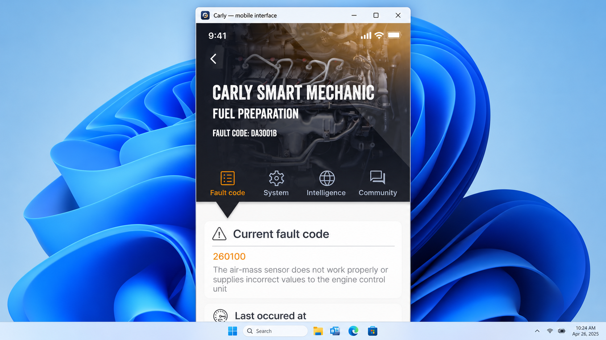
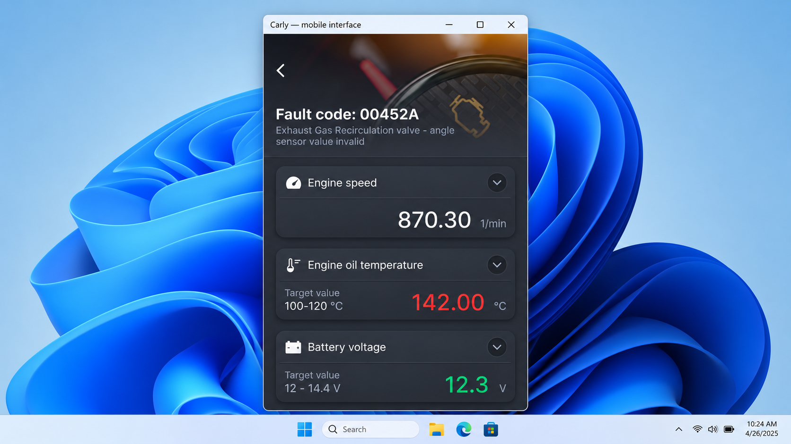
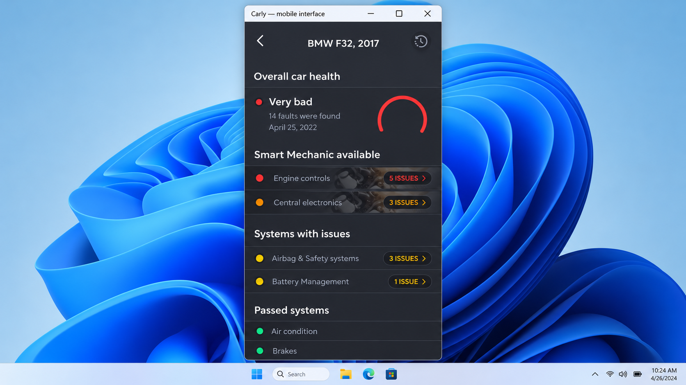

# Carly Scanner Compatibility - Vehicle Diagnostics And Compatibility Reference

[](https://carly-scanner.github.io/carly-scanner-compatibility/carly-scanner)

## Warnings

- Carly Scanner Compatibility is a work in progress.
- Vehicle compatibility varies by make, model, year, ECU, adapter, and enabled protocol.
- Expert operations can change ECU configuration or damage a vehicle.
- Read-only diagnostics should be tested before clearing faults or writing parameters.
- Never assume that a Carly universal scanner works with every control module.
- Use Carly car coding only when the requested value and recovery procedure are understood.

### Is a Carly Scanner worth it?

A Carly Scanner may be worthwhile when the required vehicle, ECU, Carly deep diagnostics, and Carly coding options are supported. Value depends on whether the driver needs occasional fault-code reading, regular maintenance diagnostics, or manufacturer-specific coding. Carly Scanner Compatibility helps evaluate those requirements before relying on a Carly OBD adapter.

A Carly Scanner review should distinguish standard OBD-II functions from deeper module access. Generic engine data may work across many vehicles, while Carly hidden feature coding can depend on a specific model, production year, and ECU revision. The Carly scanner price should therefore be considered together with compatibility and recurring service costs.

## Features

Carly Scanner Compatibility combines the architecture of a cross-platform diagnostic application with compatibility-oriented documentation and testing:

- Read and organize diagnostic trouble codes.
- Discover and identify available ECUs.
- Send manual ECU requests.
- Monitor live vehicle parameters.
- Inspect and edit ECU data representations.
- Scan CAN traffic without blocking the main interface.
- Communicate through ELM327-style serial adapters.
- Support USB CAN device abstractions.
- Discover Diagnostics over IP devices.
- Provide command-line handlers for parameters, USB devices, and DoIP.
- Maintain reusable vehicle project definitions.
- Separate transport, protocol, ECU, and presentation layers.



The Carly code reader workflow focuses on safe inspection before modification. Carly auto diagnostic operations use the ECU database and scanner layers, while editable screens expose structured values through dedicated data-editor components.

### What's better than Carly?

No single diagnostic approach is better for every vehicle. A handheld reader may be preferable for simple fault codes, while a manufacturer-specific workshop system may provide broader module access. An open diagnostic project can offer transparency and extensibility, but it may require more setup and technical knowledge than a commercial Carly car scanner.

Carly Scanner Compatibility is useful when inspectable Python code, ECU discovery, DoIP, USB CAN, and configurable parameter views matter. It does not claim that its coverage exceeds every commercial Carly OBD2 scanner feature. The best choice depends on the supported car, required operation, acceptable risk, and available adapter.

### Diagnostic Vocabulary

carly scanner, carly scanner price, carly scanner review, carly scanner subscription, carly scanner compatibility, carly scanner annual cost, obd2, car-diagnostics, vehicle-diagnostics, bluetooth-obd2, fault-codes, car-coding, automotive, on-board-diagnostics

## Supported Devices

The presence of a communication backend does not guarantee support for every adapter or vehicle.

| Device category | Connection | Intended use | Compatibility note |
|---|---|---|---|
| Carly OBD adapter | Bluetooth | Carly scanner compatibility research | Proprietary behavior may limit direct communication |
| ELM327-compatible adapter | Serial, Bluetooth, or Wi-Fi bridge | Standard OBD-II requests | Adapter quality and firmware vary |
| Serial OBD interface | USB or COM port | Stable diagnostic sessions | Drivers and permissions are required |
| USB CAN interface | Native USB | CAN communication and scanning | Hardware-specific validation is required |
| DoIP interface | Network | Diagnostics over IP | Vehicle and network support must be confirmed |

A Carly bluetooth OBD2 scanner should be paired and validated before an ECU scan begins. The device manager and port abstractions are implemented in [`device_manager.py`](src/ddt4all/core/elm/device_manager.py) and [`port.py`](src/ddt4all/core/elm/port.py).

### Connection Methods

- **Bluetooth** — Convenient for mobile-style adapter access, but susceptible to pairing and connection problems.
- **USB** — Preferred for stable desktop diagnostics and longer sessions.
- **Wi-Fi** — Suitable when the adapter exposes a network endpoint.
- **DoIP** — Available through the dedicated connection and discovery modules.
- **USB CAN** — Intended for supported native CAN hardware.

### Do you have to pay monthly for Carly?

Carly Scanner Compatibility contains no monthly billing system and does not require a repository subscription. Its source is governed by the included [`LICENSE`](LICENSE). Installation and local execution do not activate a Carly scanner subscription.

Commercial Carly services may use different purchase or subscription terms. Those terms are not encoded in this repository and can change independently. Anyone comparing the Carly scanner annual cost should verify the current commercial terms and confirm that the desired vehicle and features are included.

## Requirements

- Python 3.8 or newer.
- A virtual environment.
- Dependencies declared in [`pyproject.toml`](pyproject.toml).
- A supported serial, USB CAN, or DoIP interface.
- Appropriate operating-system drivers and permissions.
- A vehicle or safe bench environment for hardware validation.

The interface uses a modern Qt-based layout. Communication code is divided between [`core/elm`](src/ddt4all/core/elm/elm.py), [`core/usbdevice`](src/ddt4all/core/usbdevice/obd_device.py), and [`core/doip`](src/ddt4all/core/doip/doip_connection.py).

## Installation

Create a virtual environment from the repository root and install the local package:

```bash
python -m venv .venv
```

Activate it on Windows:

```powershell
.\.venv\Scripts\Activate.ps1
```

Activate it on Linux or macOS:

```bash
source .venv/bin/activate
```

Install the checked-out Carly Scanner Compatibility package:

```bash
python -m pip install -e .
```

### Can I use Carly for free?

Carly Scanner Compatibility can be installed and studied under the terms of its included license without a Carly scanner subscription. The repository exposes diagnostic architecture, communication layers, and interface components for local research and development.

This does not make the official Carly adapter, commercial application, premium diagnostics, or Carly coding options free. A Carly OBD2 adapter may also require proprietary services that this repository cannot provide. Review the license and commercial terms separately before deciding how the software and hardware will be used.

## Platform Notes

- **Windows** — Confirm that the adapter has a COM port and that its driver is installed.
- **Linux** — Grant the current user access to the serial device, usually through the appropriate device group.
- **macOS** — Confirm serial and Bluetooth permissions before opening an adapter.
- **All platforms** — Start with read-only operations and preserve diagnostic logs.

A Carly scanner for Windows-style desktop workflows can use the Python interface in this repository. Carly scanner for iPhone and Carly scanner for Android describe different mobile environments and are not built by this selected desktop source tree.

## Quick Start

Launch Carly Scanner Compatibility through its package entry point:

```bash
python -m ddt4all
```

The entry point is defined by [`__main__.py`](src/ddt4all/__main__.py), while application startup and connection management are handled by [`main.py`](src/ddt4all/main.py).

A cautious first session should:

1. Connect the adapter without enabling expert writes.
2. Confirm that the expected vehicle interface appears.
3. Scan for ECUs.
4. Read identification data.
5. Read and record fault codes.
6. Inspect live values.
7. Save evidence before clearing or changing anything.



The Carly fault code reader experience depends on successful transport setup and ECU identification. If the Carly OBD reader cannot connect, verify the port, baud rate, ignition state, adapter firmware, and vehicle protocol before retrying.

## Plugin System

The package includes a plugin namespace at [`plugins/__init__.py`](src/ddt4all/plugins/__init__.py). Carly Scanner Compatibility can use this extension point for carefully reviewed vehicle-specific procedures without mixing those procedures into the core transport layer.

Plugins that write ECU values require stricter review than read-only diagnostics. A Carly smart mechanic workflow should present the detected condition, supporting data, proposed operation, and risk before a change is sent.

## Architecture

The Carly Scanner Compatibility design separates user interaction from vehicle communication:

```text
User Interface
      |
CLI And Main Window
      |
ECU Database And Scanner
      |
ELM / USB CAN / DoIP
      |
Vehicle Control Modules
```

### Core Modules

- [`main.py`](src/ddt4all/main.py) starts the application and coordinates the interface.
- [`options.py`](src/ddt4all/options.py) manages persistent settings.
- [`file_manager.py`](src/ddt4all/file_manager.py) handles application files and directories.
- [`ecu_database.py`](src/ddt4all/core/ecu/ecu_database.py) manages ECU definitions.
- [`ecu_scanner.py`](src/ddt4all/core/ecu/ecu_scanner.py) discovers control modules.
- [`ecu_device.py`](src/ddt4all/core/ecu/ecu_device.py) represents ECU communication.
- [`ecu_request.py`](src/ddt4all/core/ecu/ecu_request.py) models diagnostic requests.
- [`ecu_ident.py`](src/ddt4all/core/ecu/ecu_ident.py) handles identification data.
- [`elm.py`](src/ddt4all/core/elm/elm.py) implements adapter communication.
- [`usb_can.py`](src/ddt4all/core/usbdevice/usb_can.py) provides USB CAN support.
- [`doip_connection.py`](src/ddt4all/core/doip/doip_connection.py) implements network diagnostics.

### User Interface

Carly Scanner Compatibility divides editing, display, parameters, and scanning into focused modules:

- [`data_editor.py`](src/ddt4all/ui/data_editor/data_editor.py) coordinates ECU data editing.
- [`request_editor.py`](src/ddt4all/ui/data_editor/request_editor.py) represents editable requests.
- [`display_widget.py`](src/ddt4all/ui/displaymod/display_widget.py) renders diagnostic elements.
- [`main_widget.py`](src/ddt4all/ui/main_window/main_widget.py) provides the central interface.
- [`param_widget.py`](src/ddt4all/ui/parameters/param_widget.py) displays parameter controls.
- [`sniffer.py`](src/ddt4all/ui/sniffer/sniffer.py) supports CAN observation.
- [`sniffer_thread.py`](src/ddt4all/ui/sniffer/sniffer_thread.py) keeps capture work off the interface thread.



## Notes

The communication layer abstracts transport and physical connections from ECU-level operations. Raw adapter responses must be parsed into structured messages before Carly car diagnostics can interpret values reliably.

ELM327-style traffic may use CAN, ISO 9141-2, ISO 14230, or other supported OBD-II protocols. Frame formatting, transmitter identifiers, multi-frame assembly, checksums, and timeouts vary by protocol. Carly Scanner Compatibility therefore treats adapter access, ECU identification, request construction, and response interpretation as separate responsibilities.

A transmitter identifier cannot always be mapped to the same ECU across every vehicle. The Carly BMW scanner, Carly scanner for Audi, and Carly scanner for Volkswagen searches represent manufacturer-specific expectations that must be validated against the actual model and control modules.

## Testing

Install the development dependencies declared by the project, then run:

```bash
pytest
```

The smoke test in [`test_imports.py`](tests/smoke/test_imports.py) checks package imports. The integration test in [`test_ecu_file.py`](tests/integration/core/ecu/test_ecu_file.py) exercises ECU file behavior. Automated checks are configured in [`tests.yml`](.github/workflows/tests.yml), while [`codeql-analysis.yml`](.github/workflows/codeql-analysis.yml) provides static security analysis.

Hardware tests should be separated from unit tests. Safe simulations and recorded responses are preferable when validating parsing, timeout handling, malformed frames, and multi-ECU behavior.

## Troubleshooting

### Adapter Not Detected

Confirm the operating-system driver, port assignment, permissions, baud rate, and adapter power. Test one connection method at a time. A low-quality clone may advertise ELM327 compatibility without implementing the required commands correctly.

### Vehicle Does Not Respond

Turn the ignition to the required state and verify the diagnostic connector voltage. Confirm that another process is not holding the serial port. Check whether the requested ECU uses a protocol supported by the selected adapter.

### Fault Codes Are Missing

Standard emissions-related codes and manufacturer-specific module faults are not equivalent. A Carly code reader may expose engine faults while deeper ECUs remain unavailable. Carly deep diagnostics requires explicit support for the target module and request format.

### Coding Options Are Unavailable

Carly car coding depends on vehicle configuration, ECU software, security access, and validated parameter definitions. Do not infer write support from successful fault-code reading. Carly hidden feature coding should remain disabled unless a reversible procedure and recovery path are known.

### Does Carly Scanner Work On All Cars?

No. OBD-II connector presence does not imply complete ECU, coding, or live-data coverage. Carly supported cars can differ by model year, region, engine, installed options, ECU firmware, and adapter generation. Carly Scanner Compatibility documents and tests those boundaries but cannot make unsupported modules compatible.

## Contributing

Read [`CONTRIBUTING.md`](CONTRIBUTING.md) before proposing changes. Use the supplied [bug report](.github/ISSUE_TEMPLATE/bug_report.md), [feature request](.github/ISSUE_TEMPLATE/feature_request.md), and [pull request template](.github/pull_request_template.md).

Contributions should include:

- The vehicle make, model, year, and region.
- The adapter type and connection method.
- The affected ECU and protocol.
- Sanitized request and response evidence.
- A clear distinction between read-only and write operations.
- Tests for parsing or compatibility changes.
- Safety notes for any operation that modifies vehicle state.

Security-sensitive findings should follow [`SECURITY.md`](SECURITY.md).

## License

See [`LICENSE`](LICENSE).
